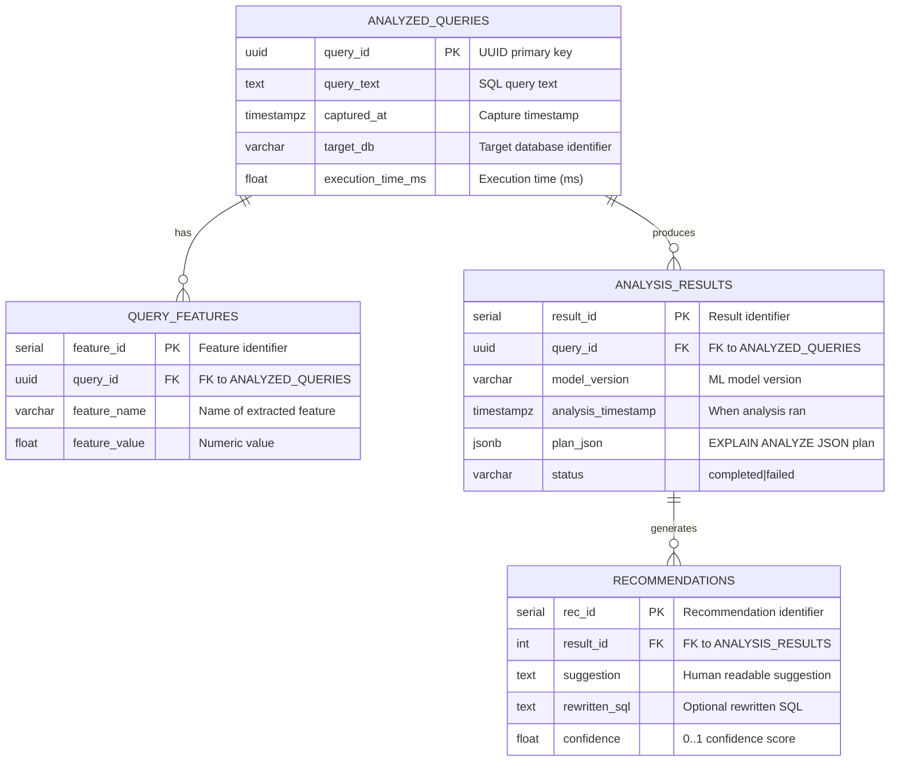

# ER Diagram (QueryDoctor)

*All foreign keys enforce referential integrity. The schema stores captured queries, extracted features, analysis results (tied to a specific model version), and recommendations linked to a particular analysis result.*
